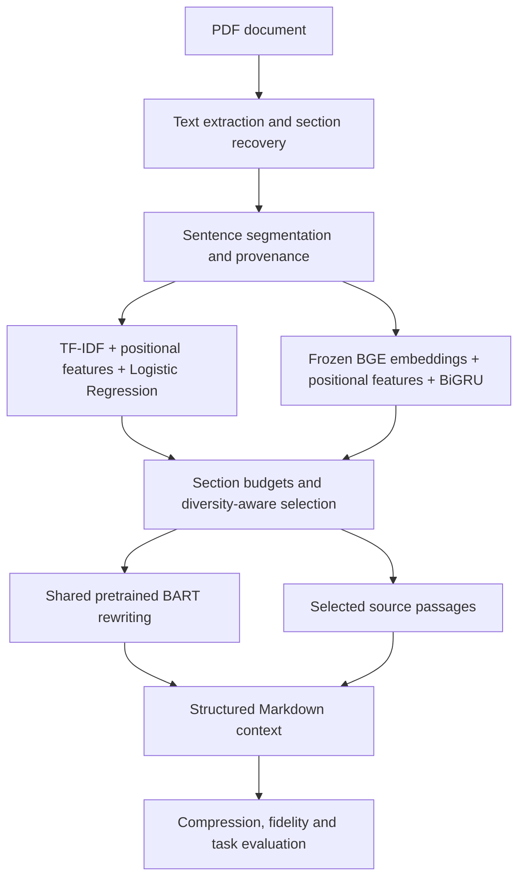

# Context Compression for LLM Pipelines

**Research prototype · Evaluation in progress · Documentation-only release**

An academic NLP project exploring how long PDFs can be converted into shorter, structured Markdown context while retaining selected source passages for checking generated claims.

**Author:** [Mayur More](https://github.com/mayurmore0812).

The aim is to reduce document tokens supplied to a downstream language model while retaining useful information. Token reduction, factual support and downstream task quality are evaluated separately. A shorter document is not automatically a faithful or adequate replacement for its source.

## Project status

The prototype implements PDF processing, two sentence-selection models, structured output and preliminary evaluation. **Evaluation is in progress.** Final benchmark conclusions, reproducible performance claims and release-ready code are not published in this repository.

This release contains project documentation only. It does not include an executable notebook, application, hosted demo, model weights, training corpus or example PDF. There is no installation or run command for this release.

## Approach

The two learned models select sentences. The shared BART rewriter is pretrained and is not trained by this project. Source passages support manual checking; they do not guarantee that the generated prose is factually supported or that every important detail was retained.

## Models and data

| Component | Role |
|---|---|
| TF-IDF + Logistic Regression | Interpretable sentence-selection baseline with positional features |
| Frozen BGE embeddings + BiGRU | Contextual sentence selection using neighbouring sentences |
| BART large CNN | Shared pretrained rewriting of selected text |
| BookSum | Narrative document/reference-summary pairs |
| arXiv summarization | Scientific-paper/reference-abstract pairs |

The prototype uses ROUGE-based approximate sentence labels and grouped partitions to reduce related-document overlap. These labels are a surrogate for reference overlap, not human annotations of factual importance.

## Evaluation focus

- Sentence ranking and minority-class selection, compared with simple baselines.
- Extractive output and rewritten output, scored separately.
- Factual support, retained information, document coverage and redundancy.
- Token counts for the complete rendered Markdown, including headings and source passages.
- End-to-end processing cost and downstream task quality.

Preliminary experiments exist, but there is no final score table in this documentation release. No fixed compression percentage, guaranteed API-cost reduction, hallucination-free output or deployment readiness is claimed.

## Documentation

- [Architecture and workflow](docs/ARCHITECTURE.md)
- [Model descriptions](docs/MODELS.md)
- [Evaluation status and measurement definitions](docs/EVALUATION.md)
- [Datasets, pretrained assets and provenance](docs/DATA_AND_SOURCES.md)
- [Output format](docs/OUTPUT_FORMAT.md)
- [Limitations and document privacy](docs/LIMITATIONS_AND_PRIVACY.md)
- [Third-party notices](THIRD_PARTY_NOTICES.md)

## Scope

The current study concerns primarily English narrative and technical documents. Scanned pages, complex layouts, tables, equations, short documents and unfamiliar domains can behave differently. It is an academic prototype rather than a validated production compression service.

## Attribution

Training/reference data: [BookSum](https://huggingface.co/datasets/kmfoda/booksum) and [arXiv summarization](https://huggingface.co/datasets/ccdv/arxiv-summarization). Pretrained assets: [BGE base English v1.5](https://huggingface.co/BAAI/bge-base-en-v1.5) and [BART large CNN](https://huggingface.co/facebook/bart-large-cnn).

Dataset authors provide the original texts/reference summaries; pretrained model authors provide the encoder and rewriter. This project develops the selection comparison and PDF-to-Markdown workflow around them. No software licence is assigned in this documentation release.
